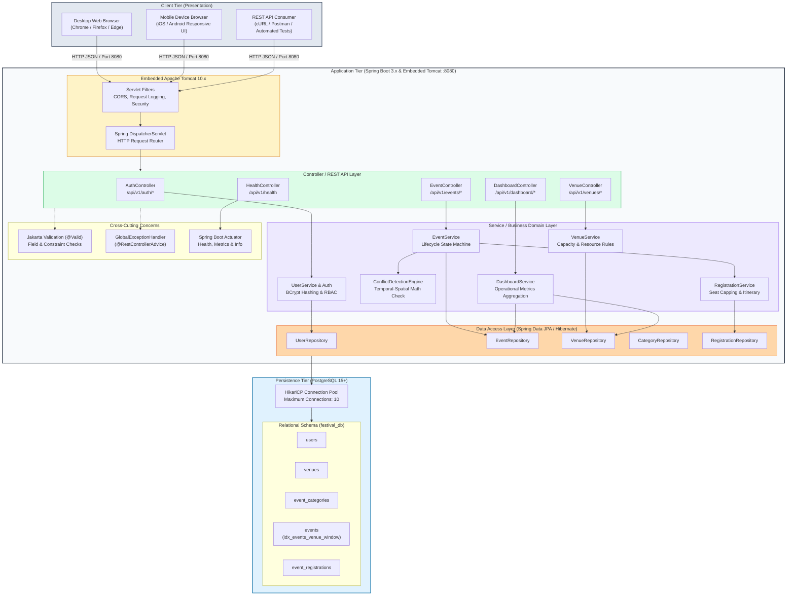
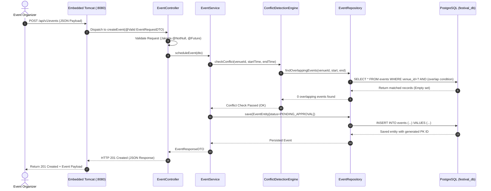

# Application Architecture & Component Diagram

This document illustrates the technical component architecture, data flow, and runtime deployment model for the **Automated Cultural Festival Schedule Platform (FestPulse)**.

---

## 1. High-Level Multi-Tier Architecture Diagram

---

## 2. Component Interaction & Request Lifecycle

