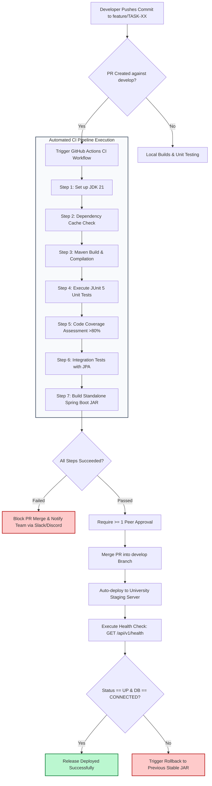

# DevOps Lifecycle & CI/CD Pipeline Workflow

This document visualizes the continuous integration, continuous delivery (CI/CD), and operational monitoring loop for the **Automated Cultural Festival Schedule Platform (FestPulse)**.

---

## 1. End-to-End DevOps Lifecycle

```mermaid
graph LR
    subgraph Development ["1. Development & Version Control"]
        PLAN[Plan & Backlog<br/>Jira / Sprint Planning] --> CODE[Feature Code<br/>Java 21 / Spring Boot]
        CODE --> BRANCH[Git Branching<br/>feature/TASK-XX]
        BRANCH --> PR[Pull Request &<br/>Peer Code Review]
    end

    subgraph CI ["2. Continuous Integration (GitHub Actions)"]
        PR --> COMPILE[Compile & Validate<br/>mvn compile]
        COMPILE --> TEST[Unit Tests<br/>JUnit 5 & Mockito]
        TEST --> SONAR[Code Quality Gate<br/>SonarQube / Checkstyle]
        SONAR --> INTTEST[Integration Tests<br/>MockMvc & JPA slice]
        INTTEST --> PACKAGE[Package JAR<br/>mvn package -DskipTests=false]
    end

    subgraph CD ["3. Continuous Delivery & Deployment"]
        PACKAGE --> DOCKER[Containerization<br/>Docker Image Build]
        DOCKER --> REGISTRY[Image Registry<br/>GitHub Packages / DockerHub]
        REGISTRY --> STAGING[Staging Deployment<br/>PostgreSQL & Tomcat 8080]
        STAGING --> SMOKE[Automated Smoke Test<br/>/api/v1/health Probe]
        SMOKE --> PROD[Production Release<br/>Zero-Downtime Rollout]
    end

    subgraph Ops ["4. Operations & Continuous Monitoring"]
        PROD --> LOGS[Centralized Logs<br/>SLF4J / Logback]
        PROD --> METRICS[Metrics Collection<br/>Spring Boot Actuator / Prometheus]
        METRICS --> DASHBOARD[Visualization<br/>Grafana Dashboards]
        DASHBOARD --> ALERT[Alerting & Feedback Loop<br/>Incident & Bug Backlog]
        ALERT -.-> PLAN
    end

    style Development fill:#e0f2fe,stroke:#0284c7,stroke-width:2px;
    style CI fill:#fef3c7,stroke:#d97706,stroke-width:2px;
    style CD fill:#dcfce7,stroke:#16a34a,stroke-width:2px;
    style Ops fill:#f3e8ff,stroke:#9333ea,stroke-width:2px;
```

---

## 2. CI/CD Automated Quality Gates Pipeline

