# Use Case Diagram

This document illustrates the actor interactions and operational use cases within the **Automated Cultural Festival Schedule Platform (FestPulse)**.

---

## 1. System Use Case Diagram

```mermaid
graph TD
    %% Actors
    STUDENT["Student Attendee / Performer"]
    ORGANIZER["Student Event Organizer"]
    ADMIN["Faculty Administrator / Dean"]
    SYSTEM["Conflict Engine & System Monitor"]

    %% System Boundary
    subgraph SystemBoundary ["FestPulse Platform (System Boundary)"]
        UC1(["UC-01: Authenticate / Register Account"])
        UC2(["UC-02: Browse Master Festival Schedule"])
        UC3(["UC-03: Filter Events by Date / Venue / Genre"])
        UC4(["UC-04: Register for Event Seat"])
        UC5(["UC-05: View Personal Itinerary (My Schedule)"])
        UC6(["UC-06: Cancel Registration"])
        
        UC7(["UC-07: Propose / Schedule Event"])
        UC8(["UC-08: Check Venue & Slot Availability"])
        UC9(["UC-09: Update Event Details / Timings"])
        UC10(["UC-10: Cancel Event"])
        
        UC11(["UC-11: Manage Venues & Capacity"])
        UC12(["UC-12: Manage Event Categories"])
        UC13(["UC-13: Review & Approve / Reject Events"])
        UC14(["UC-14: View Operational Dashboard & Analytics"])
        
        UC15(["UC-15: Detect & Block Schedule Clashes"])
        UC16(["UC-16: Monitor System & DB Health Probes"])
    end

    %% Actor to Use Case Connections
    STUDENT --> UC1
    STUDENT --> UC2
    STUDENT --> UC3
    STUDENT --> UC4
    STUDENT --> UC5
    STUDENT --> UC6

    ORGANIZER --> UC1
    ORGANIZER --> UC2
    ORGANIZER --> UC7
    ORGANIZER --> UC8
    ORGANIZER --> UC9
    ORGANIZER --> UC10
    ORGANIZER --> UC14

    ADMIN --> UC1
    ADMIN --> UC11
    ADMIN --> UC12
    ADMIN --> UC13
    ADMIN --> UC14

    %% Include / Extend Relationships
    UC7 -.->|"<<includes>>"| UC8
    UC7 -.->|"<<includes>>"| UC15
    UC9 -.->|"<<includes>>"| UC15
    UC4 -.->|"<<extends (capacity checked)>>"| UC2
    UC13 -.->|"<<triggers state change>>"| UC7

    %% System Actor
    SYSTEM --> UC15
    SYSTEM --> UC16

    style STUDENT fill:#e0f2fe,stroke:#0284c7,stroke-width:2px;
    style ORGANIZER fill:#fef3c7,stroke:#d97706,stroke-width:2px;
    style ADMIN fill:#fce7f3,stroke:#db2777,stroke-width:2px;
    style SYSTEM fill:#f3e8ff,stroke:#7e22ce,stroke-width:2px;
    style SystemBoundary fill:#f8fafc,stroke:#334155,stroke-width:2px;
```

---

## 2. Actor-to-Capability Matrix

| Use Case ID | Use Case Name | Student | Organizer | Faculty Admin | Automated System |
| :--- | :--- | :---: | :---: | :---: | :---: |
| **UC-01** | Account Authentication & RBAC | Yes | Yes | Yes | Validates |
| **UC-02** | Browse Master Festival Schedule | Yes | Yes | Yes | Serves Cache |
| **UC-03** | Filter by Date, Venue, Genre | Yes | Yes | Yes | Executes Query |
| **UC-04** | Register for Limited Event | Yes | No | No | Enforces Cap |
| **UC-05** | View Personal "My Schedule" | Yes | No | No | Aggregates |
| **UC-06** | Cancel Event Registration | Yes | No | No | Decrements Count |
| **UC-07** | Propose / Schedule New Event | No | Yes | Yes | Runs Conflict Check |
| **UC-08** | Real-time Venue Slot Check | No | Yes | Yes | Checks Overlaps |
| **UC-09** | Modify Event Time / Details | No | Yes | Yes | Validates State |
| **UC-10** | Cancel Festival Event | No | Yes | Yes | Updates Status |
| **UC-11** | Create / Edit Campus Venues | No | No | Yes | Persists Master |
| **UC-12** | Create / Edit Categories | No | No | Yes | Persists Master |
| **UC-13** | Approve / Reject Event Proposals | No | No | Yes | Publishes to Feed |
| **UC-14** | Operational Metrics Dashboard | No | Yes | Yes | Aggregates Stats |
| **UC-15** | Automated Clash Detection Engine | No | No | No | Enforces Mutual Exclusion |
| **UC-16** | Health & Database Diagnostics | No | No | No | Probes Connectivity |
